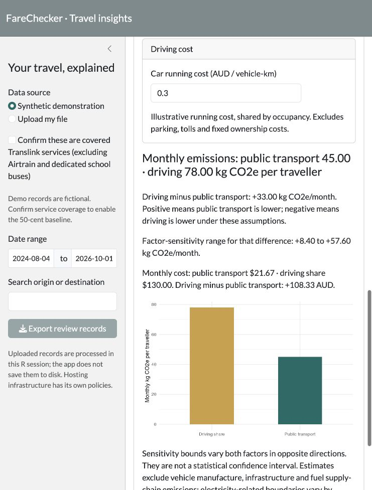

# Translink FareChecker
Understand public transport spending, investigate unusual charges and compare commuting budgets.

An R Shiny portfolio application developed from the BSAN4204 Group 10 Business Analytics Project at The University of Queensland. Includes explainable fare screening, CSV/Excel import, quality reporting, monthly and route spending, balance history, review export, a two-scenario budget planner, and a carbon/cost scenario comparison.

## What this project demonstrates

- Translate fare-policy assumptions into traceable screening rules rather than treating unusual amounts as proven overcharges.
- Separate journey charges, credits and adjustments before calculating spending metrics.
- Make uncertainty visible through row-level quality checks and carbon-factor sensitivity analysis.
- Connect descriptive spending analysis to user-controlled commuting decisions.

## Preview



The interface is in English. All bundled journey records are synthetic. See the [coursework-to-portfolio comparison](docs/project-evolution.md) for the redevelopment scope.

## Run
Requires R 4.1+; from this directory:
```r
install.packages(c("shiny", "bslib", "DT", "ggplot2", "readxl", "rmarkdown"))
shiny::runApp()
```
The initial data is fictional. Confirm service coverage to enable screening. Inspect Data quality for deliberate edge cases, then explore Fare review, Budget planner and Carbon & cost.

## Input
Required columns (case-sensitive): `Date`, `Time`, `From`, `To`, `Fare`, `Credit`, `Balance`.
Dates: YYYY-MM-DD or DD/MM/YYYY; 24-hour times: H:MM, HH:MM or HH:MM:SS. Signed amounts and parenthesized negatives are supported. Enter explicit zero for zero fares/credits; blanks remain unknown. Each row represents a transaction. On 31 October 2026, Fengyu Du reported successfully testing the application using a previous personal Translink export. This is a user acceptance check on one dataset, not independent validation of every export format or fare classification. The private export is not included; arbitrary bank statements are unsupported.

## Validation
```sh
Rscript tests/run_tests.R
Rscript tests/server_smoke.R
```
Synthetic regression checks cover date/scope boundaries, signed currency, duplicates, zero fares, invalid data and budget calculations. No real-world accuracy score is claimed. Carbon estimates use editable distances, factors and car occupancy, with sensitivity bounds. UK bus/coach presets are clearly labelled overseas examples; rail, car and running-cost defaults are illustrative assumptions, not verified Queensland factors.

## Structure
`app.R`: interface; `R/core.R`: pure analysis functions; `data/`: synthetic records; `docs/methodology.md`: assumptions and sources; `tests/`: regression checks.

## Authors and contributions

The original **BSAN4204 Group 10 FareChecker** project was jointly developed by **Fengyu Du** and **Sean Ngiam Hong Zhe**.

| Contributor | Original coursework responsibilities |
| --- | --- |
| Fengyu Du | Development of the fare-checking logic and algorithms, and the carbon-footprint estimation algorithms. |
| Sean Ngiam Hong Zhe | User interface and visual design. |

These responsibilities describe the original coursework. The original carbon-footprint work used simplifying assumptions; its attribution does not imply that a validated emissions model is included in the current version.

### Portfolio redevelopment

Fengyu Du is extending and reorganizing the project for a personal portfolio, with AI-assisted implementation and documentation. This phase adds modular validation, revised conservative fare screening, synthetic demo data, spending analysis, budget planning and regression checks. Sean's UI/design contribution refers to the original coursework, not authorship of the redesigned portfolio interface.

### Release status

This portfolio update is prepared for the existing [Dufy68/Translink-Fare-Checker](https://github.com/Dufy68/Translink-Fare-Checker) repository. The preserved original code in `archive/` is excluded from version control. No open-source licence has been selected; no reuse licence is granted by this repository. Original group-work contributions are credited above.

See [methodology](docs/methodology.md). Screening suggestions are not confirmed overcharges or guaranteed refunds.
